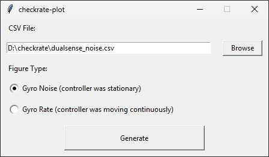

# checkrate-plot

Generate plots from [checkrate](https://github.com/ceski-1/checkrate) CSV files.



## Windows

Download [checkrate-plot.exe](https://github.com/ceski-1/checkrate-plot/raw/refs/heads/master/checkrate-plot.exe). This is a single-file executable generated by PyInstaller. Depending on your system, you may also need the latest [VCRedist](https://aka.ms/vcredist) package.

If you wish to use the Python script instead, then download the following:
- [checkrate-plot.py](https://github.com/ceski-1/checkrate-plot/raw/refs/heads/master/checkrate-plot.py)
- [requirements.txt](https://github.com/ceski-1/checkrate-plot/raw/refs/heads/master/requirements.txt)
- [Python 3.15.2](https://www.python.org/downloads/release/python-3152/)

Install Python and then install the checkrate-plot dependencies:

```
pip install -r requirements.txt
```

Then run checkrate-plot.py.

## Linux

Download the following:
- [checkrate-plot.py](https://github.com/ceski-1/checkrate-plot/raw/refs/heads/master/checkrate-plot.py)
- [requirements.txt](https://github.com/ceski-1/checkrate-plot/raw/refs/heads/master/requirements.txt)

Install the Python package provided by your distribution and then install the checkrate-plot dependencies:

```
pip install -r requirements.txt
```

Then run checkrate-plot.py. For example (may vary by system):

```
python3 checkrate-plot.py
```
